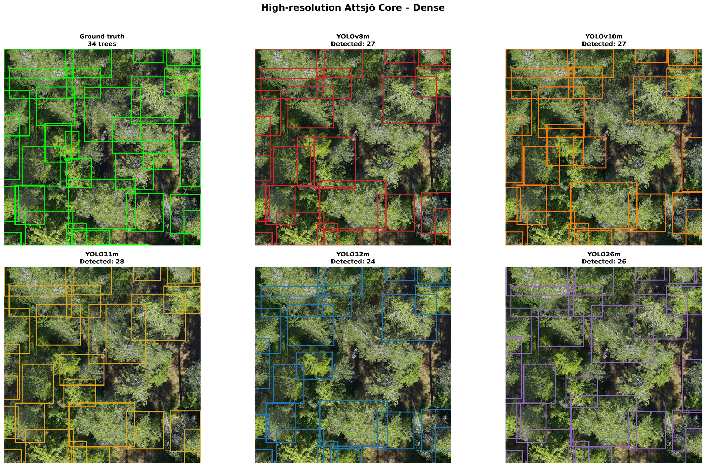
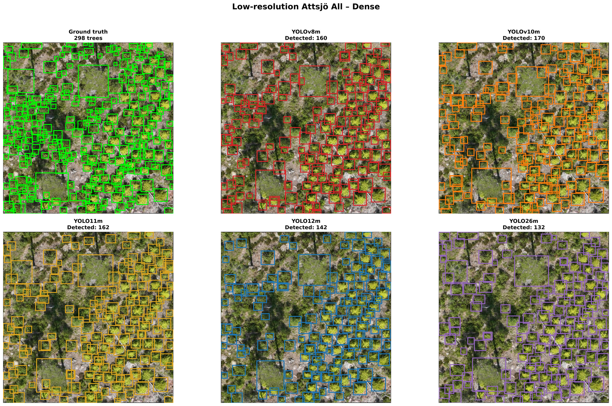
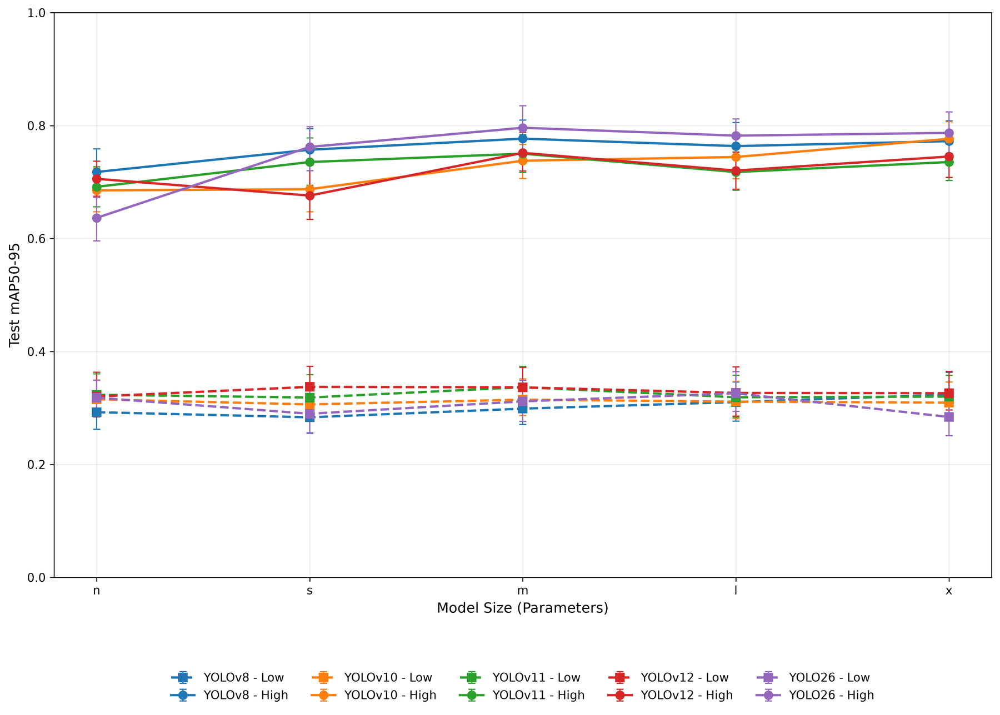

# Comparative Analysis of YOLO models on Tree Detection Using UAV RGB Imagery

A benchmark of **YOLOv8, YOLOv10, YOLO11, YOLO12, and YOLO26** for tree detection in UAV RGB imagery, covering **112 experiments** across model sizes, image resolutions, augmentation, and geographic transfer.

[Datasets](#datasets) · [Results](#benchmark-results) · [Model weights](#model-weights) · [Citation](#citation)

*Tree detection in a dense Attsjö Core test image.*

*Tree detection in a dense Attsjö All test image.*

## Datasets

UAV RGB imagery from **Attsjö** and **Svartberget**, with tree bounding-box annotations. Original and augmented datasets will be available. See the paper for dataset preparation and experimental details.

**[Download datasets — coming soon][dataset-download]**

## Benchmark results

Medium-sized models trained on augmented datasets. Parentheses show 95% confidence intervals. Higher scores are better.

### Attsjö Core — higher resolution

| Model | mAP50 (95% CI) | mAP50–95 (95% CI) |
| --- | ---: | ---: |
| YOLOv8m | 0.907 (0.872–0.939) | 0.777 (0.743–0.810) |
| YOLOv10m | 0.885 (0.855–0.912) | 0.738 (0.706–0.767) |
| YOLO11m | 0.903 (0.875–0.929) | 0.750 (0.717–0.784) |
| YOLO12m | 0.900 (0.864–0.937) | 0.752 (0.720–0.788) |
| YOLO26m | 0.917 (0.889–0.942) | 0.796 (0.754–0.835) |

### Attsjö All — lower resolution

| Model | mAP50 (95% CI) | mAP50–95 (95% CI) |
| --- | ---: | ---: |
| YOLOv8m | 0.629 (0.588–0.677) | 0.299 (0.271–0.336) |
| YOLOv10m | 0.660 (0.628–0.695) | 0.315 (0.287–0.351) |
| YOLO11m | 0.674 (0.638–0.715) | 0.337 (0.307–0.374) |
| YOLO12m | 0.670 (0.633–0.712) | 0.337 (0.307–0.372) |
| YOLO26m | 0.637 (0.591–0.683) | 0.312 (0.276–0.349) |

### Model scaling

Results for all model sizes

| Architecture | Size | All: mAP50 | All: mAP50–95 | Core: mAP50 | Core: mAP50–95 |
| --- | :---: | ---: | ---: | ---: | ---: |
| YOLOv8 | n | 0.617 | 0.293 | 0.889 | 0.718 |
| YOLOv8 | s | 0.601 | 0.283 | 0.892 | 0.757 |
| YOLOv8 | m | 0.629 | 0.299 | 0.907 | 0.777 |
| YOLOv8 | l | 0.644 | 0.310 | 0.898 | 0.764 |
| YOLOv8 | x | 0.669 | 0.324 | 0.885 | 0.772 |
| YOLOv10 | n | 0.642 | 0.315 | 0.887 | 0.685 |
| YOLOv10 | s | 0.638 | 0.306 | 0.873 | 0.687 |
| YOLOv10 | m | 0.660 | 0.315 | 0.885 | 0.738 |
| YOLOv10 | l | 0.653 | 0.311 | 0.867 | 0.744 |
| YOLOv10 | x | 0.653 | 0.309 | 0.910 | 0.777 |
| YOLO11 | n | 0.663 | 0.323 | 0.874 | 0.692 |
| YOLO11 | s | 0.658 | 0.318 | 0.897 | 0.736 |
| YOLO11 | m | 0.674 | 0.337 | 0.903 | 0.750 |
| YOLO11 | l | 0.670 | 0.319 | 0.882 | 0.718 |
| YOLO11 | x | 0.663 | 0.320 | 0.903 | 0.736 |
| YOLO12 | n | 0.670 | 0.320 | 0.890 | 0.706 |
| YOLO12 | s | 0.681 | 0.337 | 0.865 | 0.676 |
| YOLO12 | m | 0.670 | 0.337 | 0.900 | 0.752 |
| YOLO12 | l | 0.674 | 0.327 | 0.885 | 0.720 |
| YOLO12 | x | 0.674 | 0.326 | 0.902 | 0.745 |
| YOLO26 | n | 0.652 | 0.318 | 0.861 | 0.637 |
| YOLO26 | s | 0.635 | 0.290 | 0.898 | 0.762 |
| YOLO26 | m | 0.637 | 0.312 | 0.917 | 0.796 |
| YOLO26 | l | 0.664 | 0.326 | 0.901 | 0.782 |
| YOLO26 | x | 0.632 | 0.284 | 0.908 | 0.787 |

### Geographic transfer

Medium-sized models trained on Attsjö and evaluated across the full Svartberget dataset.

| Model | mAP50 (95% CI) | mAP50–95 (95% CI) |
| --- | ---: | ---: |
| YOLOv8m | 0.522 (0.493–0.550) | 0.175 (0.164–0.186) |
| YOLOv10m | 0.574 (0.544–0.607) | 0.201 (0.189–0.216) |
| YOLO11m | 0.435 (0.409–0.458) | 0.134 (0.124–0.143) |
| YOLO12m | 0.582 (0.551–0.611) | 0.187 (0.175–0.200) |
| YOLO26m | 0.534 (0.507–0.560) | 0.170 (0.161–0.182) |

Additional results: [all 112 experiments](reviewer_results/tables/Table_All112_PrimaryTestMetrics_Native8430.csv) · [full-site transfer](reviewer_results/tables/Table_FullSvartberget_ExternalGeneralization.csv).

See the paper for the evaluation protocol and analysis.

## Model weights

**[Download model weights — coming soon][weights-download]**

## Citation

Publication details and BibTeX will be added when available.

## License

Dataset and model-weight licenses will be added with the public release.

<!-- Replace these destinations with the external download URLs when published. -->
[dataset-download]: #datasets
[weights-download]: #model-weights
